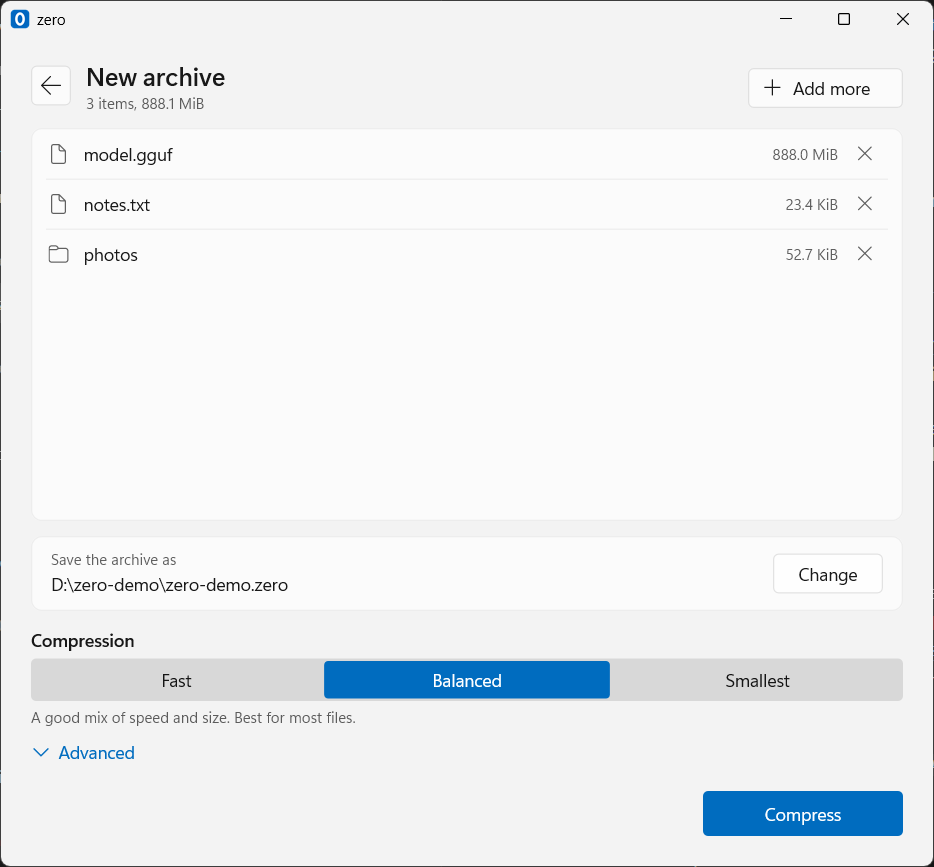
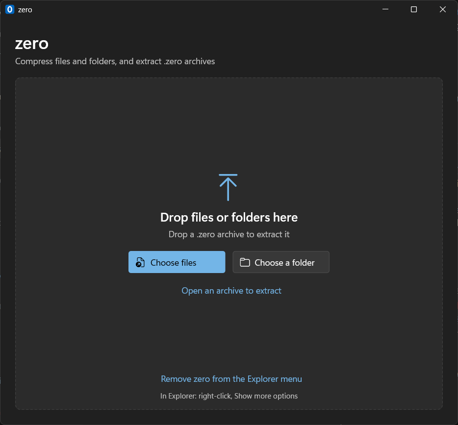
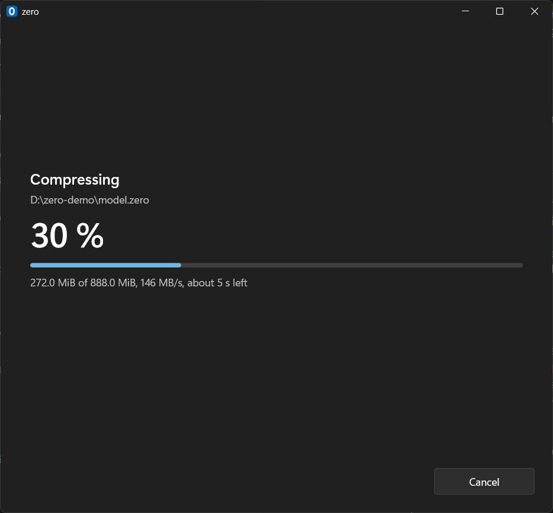

# zero

**Compress files and folders on your GPU.** zero is a lossless compressor that runs on Intel Arc and Iris graphics through Level
Zero, with its own format built for how a GPU decodes. It has a Windows 11 window, Explorer integration and a command line. If the
GPU is missing or fails, the CPU does the work, and an archive made by either can be read by the other.



| | |
|---|---|
|  |  |

## Install

**Windows:** build it as shown below, then run `bin\zero-setup.exe` and press Install. It needs no administrator rights and takes
one file. Remove it in Settings, Apps. Windows may warn about an unknown publisher, because the program is not signed.

**Linux:** `./build.sh`, then `./install.sh`. `./install.sh --uninstall` removes it. For the GPU you need Intel's compute runtime
(`intel-opencl-icd`, `intel-level-zero-gpu`). The Linux build has been compiled and its command line run in a container with the CPU
codec. Its window and its GPU path have not been run yet.

## Use

**In the window**, drop files or folders on it and press Compress. Drop a `.zero` archive and press Extract. The name and place are
suggested for you, and block size and processor are under Advanced.

**In Explorer**, with "Add to the Explorer menu" chosen when installing:

- Double-click a `.zero` archive to see what is in it.
- Right-click files or folders, then Show more options, then Compress with zero.
- Right-click an archive, then Show more options, then Extract here.

Windows 11 keeps these under Show more options, because its first menu takes only signed packages.

**On the command line:**

```
zero c photos report.docx -o backup.zero   # files and folders into one archive
zero l backup.zero                         # list what is inside
zero t backup.zero                         # check every checksum
zero x backup.zero -o restored             # extract into a folder
zero x backup.zero --cpu                   # with the CPU codec
zero bench big.bin                         # measure one file in memory
zero info                                  # the GPU, its driver, the kernel cache
```

| Option | Meaning |
|---|---|
| `--level 1..9` | how hard to look for matches: 1 fast, 5 default, 9 thorough |
| `--block 16..20` | block size as log2 bytes, 64 KiB to 1 MiB, default 18 (256 KiB). Larger gives smaller archives and slower GPU decoding |
| `--cpu` | use the CPU instead of the GPU |

## GPU or CPU?

On a Core Ultra 5 125H laptop with an Arc iGPU, whole program, 6.46 GiB of Windows DLLs:


| | Compress | Size | CPU time to compress | Check archive |
|---|---|---|---|---|
| GPU | 24.6 s | 43.4 % | 35 s | 4.0 s |
| CPU, 18 threads | 22.6 s | 41.5 % | 323 s | 3.9 s |

- **The GPU, the default, leaves your CPU free.** It takes about the same time on large files and about a ninth of the CPU time.
- **It compresses data that hardly compresses faster.** 2 GiB of random data took 5.5 s against 8.5 s.
- **The CPU makes smaller archives** and is faster on small files, where opening the GPU and setting up its memory take longer than
  the work.

[The benchmarks](docs/benchmarks.md) have every data set, the method, and how to measure it yourself.

## What keeps your data safe

- Every block and every file carries a CRC-32. Extracting and `zero t` check them all, and a damaged archive is refused.
- If the GPU fails in the middle of a job, the CPU finishes it and the archive is still right.
- An unfinished archive is removed if a job fails or is cancelled.

Do not rely on any archive you have not tested: `zero t` costs seconds.

## Build

**Windows:** Visual Studio Build Tools with "Desktop development with C++", then:

```
.\build.ps1
```

This gives `bin\zero.exe`, `bin\zero-gui.exe` and `bin\zero-setup.exe`, statically linked, with no runtime to install.

**Linux:** g++ 13+ or clang++ 17+, then `./build.sh`. The window loads GTK 3 at run time, so no GTK development packages are needed.

There are no other dependencies. The GPU driver supplies Level Zero and the kernel compiler. Compiled kernels are cached in
`%LOCALAPPDATA%\zero\kernels` (Linux: `~/.cache/zero/kernels`), so the first run on a GPU takes about two seconds longer.

## Tests

| Script | What it checks |
|---|---|
| `tests/roundtrip.ps1` | a folder through both codecs in all four combinations, with hashes compared |
| `tests/stress.py` | awkward data at every block size and level, damaged archives, and that the GPU is never lost |
| `tests/gui_block_switch.ps1` | the window through several archives with different block sizes in one process |
| `tests/explorer_menu.ps1` | the Explorer commands, double-clicking an archive, and removing the entries |
| `tests/installer.ps1` | install, update and uninstall, and that nothing is left |
| `tests/compare_cpu_gpu.py` | [the benchmarks](docs/benchmarks.md) |

They use the GPU, and some open windows. `tools/gpu_gate.ps1` checks that no other program is using the GPU first.

## How it works

Blocks are compressed independently with LZ77 and rANS. In the format, tokens decode side by side in groups, one per lane, with a
memory fence only between groups. [How it works](docs/how-it-works.md) covers the format, the kernels, and everything that was tried
and dropped, with numbers.

## Not done yet

- Archives cannot be extracted one file at a time.
- Symbolic links and Windows attributes are not kept.
- The window is not read by screen readers, and it is in English only.
- The Linux window is the plain GTK one, and it has not been opened on a desktop.
- The installer is not signed.

## License

Apache License 2.0.
